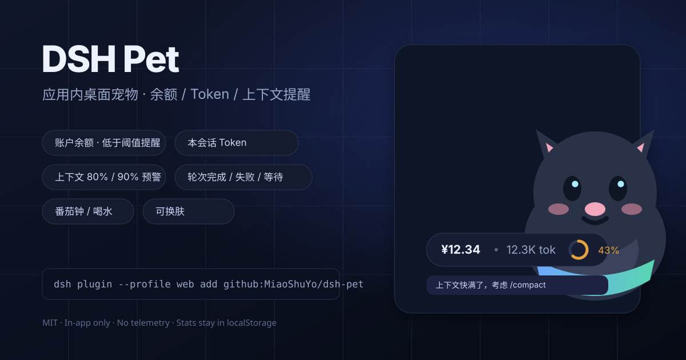
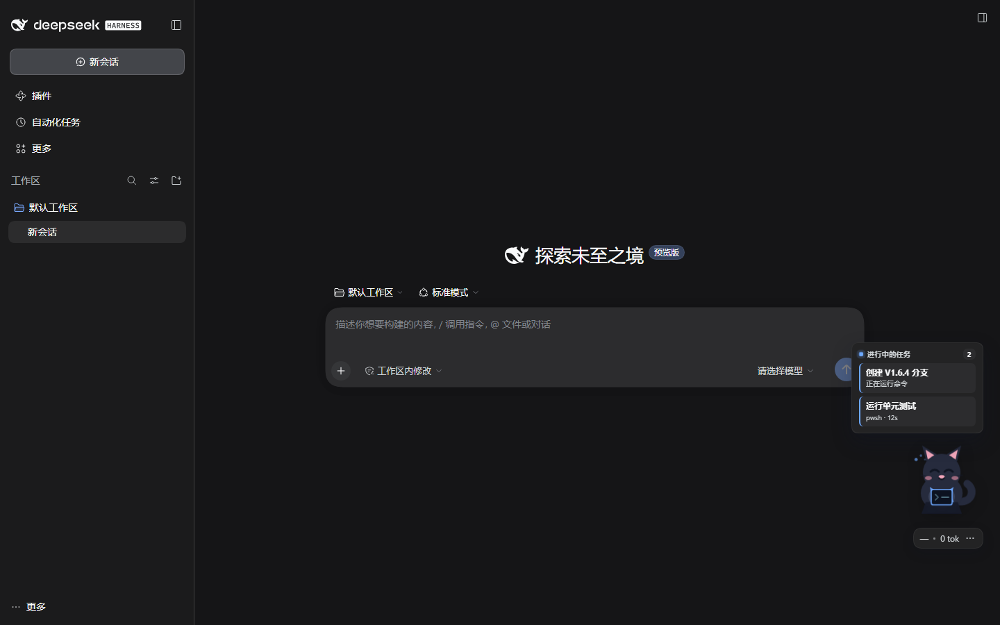
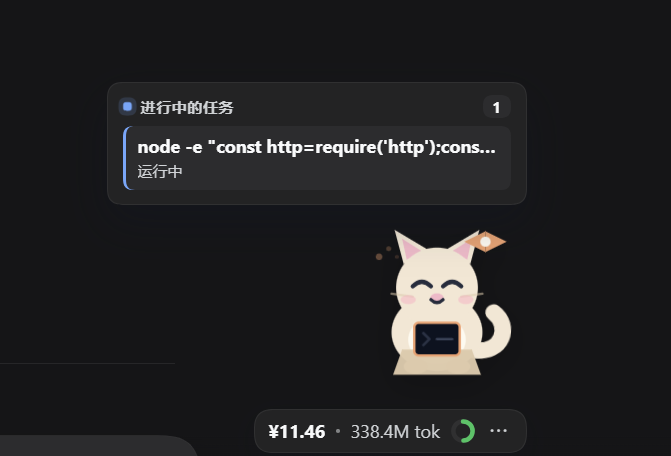
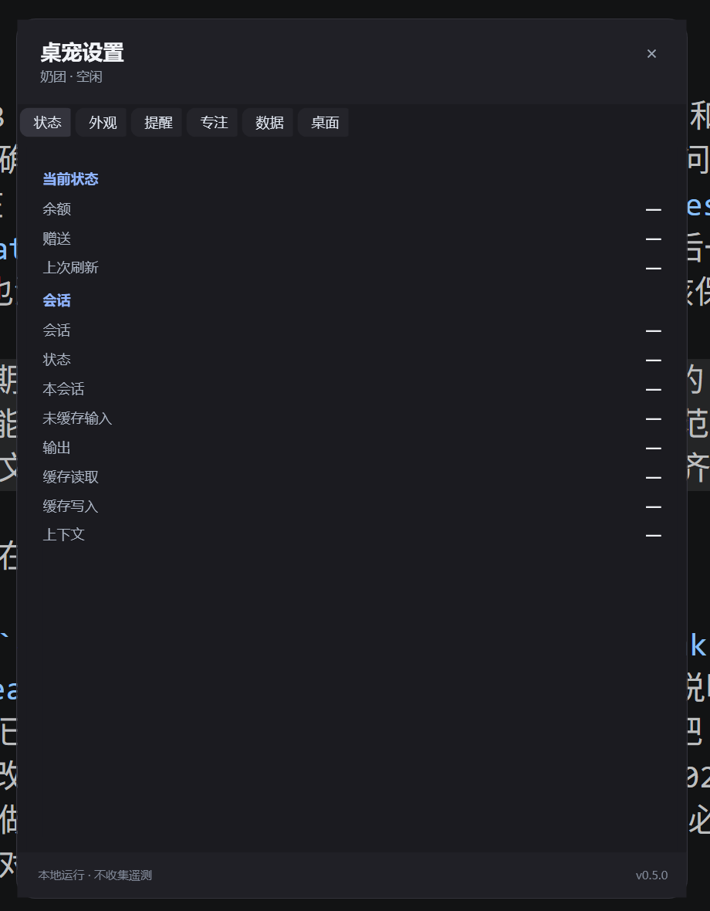

# DSH Pet · 桌宠

> 给 [DeepSeek Harness](https://github.com/deepseek-ai/deepseek-harness)（`dsh`）桌面客户端用的 **Windows 桌面宠物**：宠物只显示在独立的透明置顶窗口里，不占用 DSH 页面；显示账户余额、本会话 token、上下文占用和正在执行的任务。









> 仓库地址已指向 **MiaoShuYo/dsh-pet**。如要迁移到别的账号，替换本文件、`package.json`、`site/index.html` 中的 `MiaoShuYo`；CI、Release 包名与 Pages 索引会自动从 `GITHUB_REPOSITORY` 读取真实仓库地址。

## 功能

- **纯桌面宠物**：DSH 页面里不再渲染任何宠物或设置面板；重启 Host 后自动启动独立置顶窗口。
- **拖动与双击**：拖动宠物移动窗口；**双击宠物打开/聚焦 DSH**。
- **任务卡**：当前会话的后台 job 与同步工具调用显示在宠物上方；标题优先取 `description`，其次命令首行。
- **状态牌**：余额 · 本会话 token · 上下文百分比，数据来自 DSH 既有 projection/Remote。
- **与 DSH 内完全相同的设置面板**：独立窗口直接运行同一套 React 桌宠 UI（状态/外观/提醒/专注/数据），不是 WPF 重绘；右键宠物 → 设置。
- **外观**：三套内置皮肤、大小、不透明度、状态牌/任务列表开关、名字、语言。
- **提醒 / 专注 / 数据**：低余额与上下文阈值、完成/等待提醒、番茄钟与喝水、每日统计与重置、演示状态。
- **托盘**：托盘菜单可重新打开设置、显示/隐藏宠物或退出。
- **中英任务/状态文案**，跟随 DSH 界面语言。

## 兼容性

| 项 | 范围 |
|---|---|
| DSH | `>=0.2.0-rc.2 <0.3.0`（当前验证目标 0.2.1-rc.5） |
| 客户端 | DSH 桌面应用（Windows）；插件仍通过 Web Client 读取会话数据 |
| Node（开发） | >= 20，无运行时依赖 |
| 平台 | **Windows 10/11 + WebView2 Runtime**（独立桌面窗口）；macOS / Linux 暂无桌面宠物 |

## 安装

先安装到 Web profile，然后**完全退出并重启** DSH（Host 会缓存插件模块），再到「插件」页启用它。

### 方式 A：GitHub Release 预构建包（最稳）

```bash
dsh plugin --profile web add https://github.com/MiaoShuYo/dsh-pet/releases/download/v0.8.0/dsh-pet-0.8.0.tgz
```

### 方式 B：直接从 GitHub 安装

```bash
dsh plugin --profile web add github:MiaoShuYo/dsh-pet#v0.8.0
```

`lib/client.js` 已提交到仓库，因此不需要在安装时执行构建脚本，也不需要 pnpm 的 `allowBuilds` 授权。Windows 独立窗口的 PowerShell helper 与宠物 PNG 已包含在包内，使用系统自带的 Windows PowerShell，不需要另外安装 Electron 或运行时。

### 方式 C：插件市场

1. 在「插件」页打开实验性的 **自定义插件市场**（若未启用）。
2. 进入 **发现 → 添加索引源**，填入：

```text
https://miaoshuyo.github.io/dsh-pet/index.json
```

3. 找到 **DSH Pet**，确认来源后安装。

> 「发现」页读取的是 GitHub Pages 索引；仓库 Settings → Pages → Source 需选择 **GitHub Actions**，release 工作流会自动部署。

### 从源码安装（开发）

```bash
git clone https://github.com/MiaoShuYo/dsh-pet.git
cd dsh-pet
dsh plugin --profile web add ./
```

### 启用与卸载

- 安装后「插件」页会出现 `dsh-pet`；如果显示为关闭，手动打开。
- 卸载：`dsh plugin --profile web remove dsh-pet`，然后重启 DSH。
- 升级：重新执行 `add`（或市场里安装新版本），再重启 DSH。

## 使用

- **启动**：安装并重启 DSH 后，Host 会自动启动桌面宠物；DSH 页面里不会出现宠物。
- **拖动**：按住宠物拖动；位置保存在本机 `%LOCALAPPDATA%\dsh-pet\window.json`。
- **双击宠物**：打开/聚焦 DSH 窗口。
- **右键宠物**：设置、打开 DSH、回到屏幕右下角、隐藏到托盘。
- **托盘**：打开设置、显示/隐藏宠物、退出桌面宠物。
- **设置页**：
  - 外观：皮肤、大小、不透明度、状态牌/任务列表、名字、语言
  - 提醒：低余额阈值/币种、上下文阈值、完成/后台/等待提醒、通知/提示音
  - 专注：番茄钟、休息、喝水
  - 数据：每日统计开关、今日 token/余额变化、重置统计、演示状态
  - 桌面：余额刷新间隔、复位位置、打开 DSH、导入/导出设置
- **任务卡**：当前会话有任务时显示，最多 3 条；任务结束自动消失。
- **隐藏/退出**：右键 → 隐藏到托盘；托盘菜单可退出。

### 数据来源

| 显示 | 来源 |
|---|---|
| 余额 / 账户状态 | DSH 既有 Remote：`account/getState`、`account/getBalance` |
| 本会话 token | Session projection `tokenUsage`（四类桶） |
| 上下文占用 | Session projection `contextPressure`（`projectedTokens`/`pressureTokens` ÷ `contextWindow`） |
| token 构成 | Session projection `contextBreakdown`（system / tools / messages） |
| 进行中的任务 | `ctx.jobs` 的 `job.list` 任务流 + 当前会话事件流中的 `tool/call` / `tool/result`（标题取 `arguments.description` 或命令首行） |
| 轮次/等待/完成 | Client `useSessionStatus`（running / pendingInteraction / completionUnread） |
| 今日统计 | 本机 localStorage 中的累计差值 |

插件不新增任何网络请求；余额读取复用 DSH 已经提供给账户设置页的 Remote。未登录、API-key-only、没有 token-meter 或断网时会降级显示 `—` / “账户不可用”，不影响 DSH 正常使用。

### 本机存储

| Key | 内容 |
|---|---|
| `dsh-pet:prefs:v1` | 位置、尺寸、透明度、语言、阈值、通知/声音、番茄钟等偏好 |
| `dsh-pet:skins:v1` | 导入的图片皮肤 |
| `dsh-pet:stats:v1` | 每日 token 桶与余额首末值（最多 60 天） |

清空浏览器站点数据或删除这些 key 即可重置；面板里也提供“清除统计”“导出/导入设置”。

## 皮肤

内置 `Kuro`（小黑）、`Mochi`（奶团）、`Pixel`（像素）。导入格式：

```json
{
  "format": 1,
  "kind": "image",
  "id": "night-cat",
  "name": "Night Cat",
  "images": {
    "idle": "data:image/png;base64,...",
    "working": "data:image/png;base64,...",
    "waiting": "https://example.com/waiting.png"
  }
}
```

- 只有 `idle` 必填；其余状态缺失时回退 `idle`。
- 单张 ≤ 512KB，总计 ≤ 3MB；只接受 png/jpeg/webp/gif 的 data URL 或 https URL。
- 完整规则与安全说明见 [docs/skins.md](docs/skins.md)。

## 隐私

- 不收集遥测，不上传聊天内容、token、余额或皮肤。
- 余额来自 DSH 自己的账户 Remote；插件不读取或保存凭据。
- 外部 `https:` 皮肤图片只在你主动导入并启用该皮肤时由浏览器加载；担心隐私请用 data URL。
- 统计与偏好只在本机 `localStorage`。

## 开发

```bash
npm run build      # 由 src/ 生成 lib/client.js（零依赖迷你打包器）
npm run check      # manifest / 版本 / 语法 / bundle 新鲜度 / 包装器不变量
npm test           # node:test：纯函数、store 状态机、headless bundle 烟测
```

目录：

```text
src/shared/      纯函数：格式化、阈值、几何、偏好、皮肤校验、统计、番茄钟、气泡
src/client/      store（非 React 状态）、UI、矢量宠物、样式、词典、浏览器副作用
scripts/         build-client.mjs（零依赖打包）、check.mjs、market-index.mjs
lib/             lib/index.js（Host 空插件）+ lib/client.js（已提交的浏览器 bundle）
tests/           node:test
site/            GitHub Pages：index.html、icons/、生成的 index.json
docs/            skins.md、QA.md、preview.svg
```

本地迭代：

1. 修改 `src/` 后执行 `npm run build && npm run check && npm test`。
2. 若通过 `add ./` 链接安装，`lib/client.js` 就是插件实际加载的文件；保存后在浏览器刷新页面。若仍加载旧版，完全退出并重启 DSH。
3. 新增或修改 Host 半（`lib/index.js`、`cordis.patch.yml`）必须重启 Host。
4. 手工验收清单见 [docs/QA.md](docs/QA.md)。

> 不要只把文件复制进 `node_modules` 或手改 profile 的 `cordis.patch.yml`：插件能跑，但「插件」页不会列出它，也无法在 UI 里启停/移除。请始终用 `dsh plugin add` 安装。

## 发布到 GitHub

1. 新建仓库（建议名 `dsh-pet`），把本目录推上去。
2. 仓库地址已指向 `MiaoShuYo/dsh-pet`；如需更换账号，替换 README、`package.json`、`site/index.html` 中的 `MiaoShuYo`。
3. 仓库 Settings → Pages → Source 选择 **GitHub Actions**。
4. 发布版本：

```bash
git tag v0.8.0
git push origin v0.8.0
```

release 工作流会：

- 运行 `build` / `check` / `test`；
- `npm pack` 并把 `dsh-pet-0.8.0.tgz` 挂到 GitHub Release；
- 从所有 `v*` tag 生成 `site/index.json` 并部署到 GitHub Pages。

> 首次手动开启 Pages 时，`github-pages` 环境默认只允许 `main` 部署。如果 Release 工作流提示 “Tag `v0.8.0` is not allowed to deploy to github-pages”，到 Settings → Environments → github-pages → Deployment branches and tags 添加 `v*` tag 规则。本仓库已添加。

也可以本地预览市场索引：

```bash
npm run market:index
# 打开 site/index.json；site/index.html 可直接作为静态页预览
```

## 已知限制

- **仅 DeepSeek Platform 账户**：API-key-only 环境没有可读余额，会显示“账户不可用/未登录”，这是既有能力边界。
- **上下文占用是近似值**：分子是最近一次请求的 provider 用量（或 surface 预计值），分母是该路由声明的 `contextWindow`；切换模型时两者可能短暂配对不上。这是 DSH token-meter 自身的设计，不是插件另算。
- **仅 Windows 桌面窗口**：按要求不再在 DSH 页面内渲染宠物；macOS / Linux 暂无桌面宠物。
- **独立窗口是透明 WebView2 无边框窗口**：Host 用 WebView2 打开一个无边框、置顶的独立窗口，隐藏 DSH 主体并运行同一套 React 宠物/设置 UI；WPF 窗口、WebView2 背景和页面背景都透明，宠物/气泡/状态牌没有黑色矩形底；顶部 22px 可拖动，托盘可退出。
- **需要 Microsoft Edge WebView2 Runtime**：Windows 10/11 自带；桌面窗口打开失败时检查 Edge 是否可用。
- **需要 Windows PowerShell**：helper 随插件打包，不额外下载；启动失败可查看 `%LOCALAPPDATA%\\dsh-pet\\last-error.txt`。
- **DSH 预 1.0**：扩展点仍在演进；`engines.dsh` 锁定 `<0.3.0`，升级 DSH 后请先跑 `docs/QA.md`。
- 首次安装/升级后必须重启 Host，刷新页面不足以加载新的 Host 插件。

## License

MIT。所有内置宠物形象均为本项目原创矢量图形；不包含任何第三方角色素材。第三方皮肤由导入者自行负责版权。

---

## English

DSH Pet is a **Windows desktop pet** for [DeepSeek Harness](https://github.com/deepseek-ai/deepseek-harness). The host starts a separate transparent, borderless, always-on-top WPF window; the DSH page renders no pet. It shows account balance, per-session token usage, context-window occupancy and live running tasks.

**Highlights**

- **Windows desktop pet only**: no in-app overlay; the host auto-starts the companion.
- Drag to place it anywhere; **double-click the pet to focus/open DSH**.
- Native settings window (Appearance, Alerts, Focus, Data, Desktop) reached by right-click or the tray icon.
- Live task card from the client job roster **and the session event feed** (running `tool/call` entries), plus a laptop-holding busy pose while work runs.
- Balance / token / context plaque from the existing projections and account Remote.
- Tray menu to reopen settings, show/hide the pet, or exit.
- Three original vector skins (native settings), working/waiting/happy/sad state images.
- Chinese/English task/status text; Windows-only.

**Install** (repository: `MiaoShuYo/dsh-pet`):

```bash
dsh plugin --profile web add github:MiaoShuYo/dsh-pet#v0.8.0
# or a release tarball
dsh plugin --profile web add https://github.com/MiaoShuYo/dsh-pet/releases/download/v0.8.0/dsh-pet-0.8.0.tgz
```

Restart DSH completely, then enable **dsh-pet** on the Plugins page. The market index is `https://miaoshuyo.github.io/dsh-pet/index.json`.

**Develop**

```bash
npm run build && npm run check && npm test
```

`lib/client.js` is committed because GitHub installs do not run a build. The Windows companion's PowerShell script and PNG assets are bundled; it uses the system Windows PowerShell, with no Electron or extra runtime install. See `docs/QA.md` for the manual matrix; `src/` is the source of truth, and the build has no dependencies.

**Compatibility** — Windows 10/11; DSH `>=0.2.0-rc.2 <0.3.0`. Balance requires a DeepSeek Platform account. API-key-only setups show the account as unavailable. Context occupancy is the approximate value DSH itself exposes. macOS/Linux have no desktop pet yet.

**License** — MIT. Built-in pet art is original vector work; no third-party character assets are bundled.
